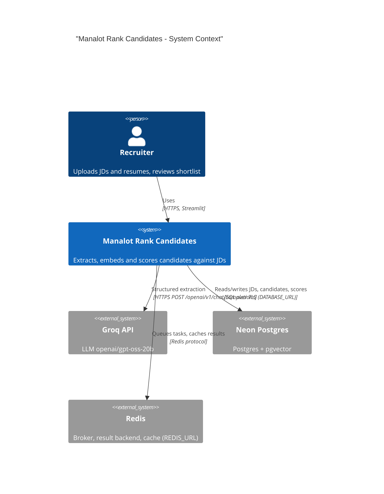
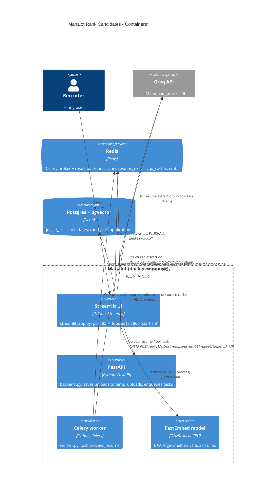
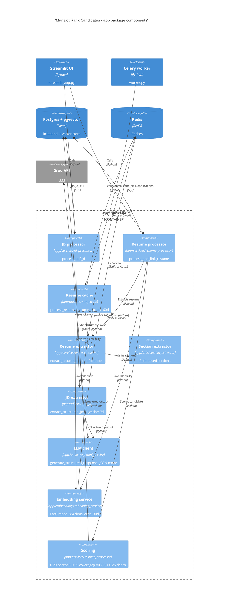

# Architecture: Manalot Rank Candidates

Manalot ranks candidate resumes against a job description (JD). A recruiter works in a Streamlit UI. Resume extraction runs asynchronously through FastAPI and a Celery worker, with Redis as broker, result backend and cache. Structured extraction uses the Groq LLM (`openai/gpt-oss-20b`, JSON mode). Embeddings come from FastEmbed `BAAI/bge-small-en-v1.5` (384 dims), running locally on CPU. Data is stored in Postgres + pgvector (Neon in production). The README still describes Gemini and 768 dims; that is out of date.

## System context

Flows: [FLOW-01](flows/web/upload-jd-flow.md), [FLOW-02](flows/web/ingest-resumes-flow.md), [FLOW-03](flows/web/score-candidate-flow.md), [FLOW-04](flows/web/view-shortlist-flow.md), [FLOW-05](flows/web/cache-maintenance-flow.md), [FLOW-06](flows/api/task-status-flow.md).

## Containers

Flows: [FLOW-01](flows/web/upload-jd-flow.md), [FLOW-02](flows/web/ingest-resumes-flow.md), [FLOW-05](flows/web/cache-maintenance-flow.md), [FLOW-06](flows/api/task-status-flow.md).

## Components (`app/` package)

Flows: [FLOW-01](flows/web/upload-jd-flow.md), [FLOW-02](flows/web/ingest-resumes-flow.md), [FLOW-03](flows/web/score-candidate-flow.md), [FLOW-04](flows/web/view-shortlist-flow.md).

## Known architectural risks

- Path traversal: upload filenames are used unsanitised when writing to `temp_uploads`.
- Cache maintenance runs Redis `FLUSHALL`, which also wipes the Celery broker queue and task results.
- The UI runs extraction again in-process after the worker has finished, so LLM calls are duplicated and the async path does nothing useful.
- `start.sh` and docker-compose start a `backend_api` module that does not exist; the live API is `backend.py`.
- The FastAPI endpoints have no authentication, and the UI hardcodes `http://localhost:8000/api/v1`.
