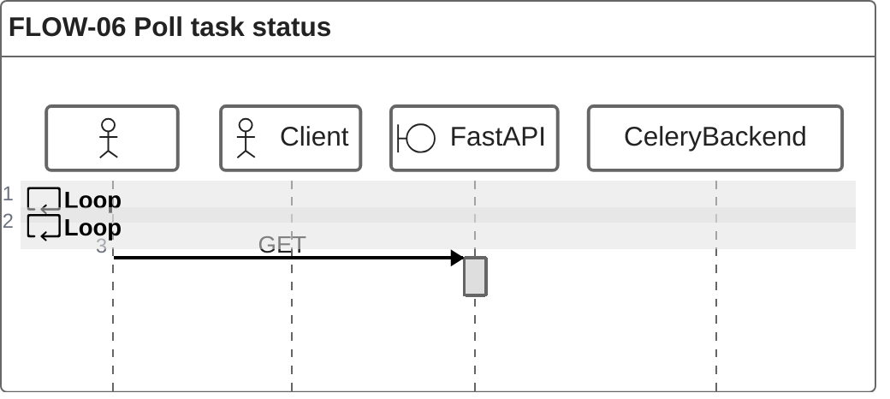

# FLOW-06 Poll task status

Note: an unknown task id is also `PENDING`, so it reports "Processing..." forever. A task whose pipeline raised still ends `SUCCESS` with `{"status": "failed"}` inside `result`, because the worker catches the exception.
